<div align="center">
     <h1>Minecraft 旅游系统 <sup style="background-color: #28a745; color: white; padding: 2px 6px; border-radius: 3px; font-size: 0.4em; vertical-align: super; margin-left: 5px;">v1.0.0</sup></h1>
     <h3>一站式智慧旅游服务平台</h3>
     <p>Spring Boot 3 + Vue 3 + uni-app — 一套后端，多端覆盖（Web 用户端 / 管理端 / 移动端 / 即时通讯 / 桌面端 / Android）</p>
     <p align="center">
          
          
          
          
          
          
          
          
          
     </p>
</div>

> 一站式智慧旅游服务平台，为用户提供景点推荐、酒店预订、票务与铁路出行、美食推荐、特产商城、物流售后、出行计划、社区交流、即时通讯等全方位旅游服务。

## 项目简介

Minecraft 旅游系统是一个基于 Spring Boot 3 + Vue 3 构建的综合性旅游服务平台，采用前后端分离架构。项目由 **后端服务**、**Web 用户端**、**管理端**、**旅游移动端** 与 **即时通讯多端矩阵**（uni-app 移动端 / 桌面端 / Android 原生端）组成，内置推荐引擎、聚合支付、物流与售后、RBAC 权限、Excel 异步导入导出、二维码扫码登录、WebSocket 实时通信、3D 地球可视化等特色能力。

- 后端：`102` 个控制器、`202` 个服务类、`176` 个 Mapper、`173` 个实体、`191` 张数据表
- 前端：Web 用户端、Vben Admin 管理端、uni-app 旅游 App、uni-app IM App、Adrenaline.js 桌面 IM、Kotlin Compose Android IM
- 多语言：中文（zh-CN）/ 英文（en-US）
- 主题：支持浅色 / 深色 / 主题切换

## 项目组成

| 子项目 | 说明 | 技术栈 | 开发端口 |
|--------|------|--------|----------|
| `Minecraft-System/` | 后端服务 | Spring Boot 3 + MyBatis Plus | 8080 |
| `minecraft-ui/` | Web 用户端 | Vue 3 + Element Plus + Vite | 8090 |
| `minecraft-admin-main/` | 管理端 | Vue Vben Admin 5.7（Ant Design Vue Next） | 5999 |
| `minecraft-App/` | 旅游移动端 | uni-app 3（App / H5 / 小程序） | HBuilderX |
| `Minecraft-ImChat/` | 移动端即时通讯（博览通讯） | uni-app 3（App / H5） | HBuilderX |
| `minecraftIM-PC/` | 桌面端即时通讯 | Adrenaline.js + Vue 3 + Element Plus + TypeScript | 5178 |
| `AndroidIM/` | Android 即时通讯 | Kotlin + Jetpack Compose + Hilt | - |

## 技术栈

### 后端技术（Minecraft-System）

| 技术 | 版本 | 说明 |
|------|------|------|
| Java | 17 | 开发语言 |
| Spring Boot | 3.0.2 | 基础框架 |
| Spring Security | - | 安全框架（JWT + RBAC） |
| MyBatis Plus | 3.5.3.2 | ORM 框架 |
| Druid | 1.2.24 | 数据库连接池 / SQL 监控 / wall 防火墙 |
| MySQL | 8.0 | 关系型数据库 |
| Redis | Lettuce | 缓存 / 会话存储（不可用时自动降级直查 DB） |
| WebSocket | - | 实时通信（IM、音视频信令、扫码登录） |
| JWT (jjwt) | 0.12.5 | 身份认证（默认 7 天有效期） |
| Aliyun OSS | 3.15.1 | 对象存储 |
| TIANAI-CAPTCHA | 1.5.5 | 滑块验证码 |
| EasyExcel | 3.3.4 | 异步导入导出 |
| Spring Mail | - | 邮件服务 |
| SpringDoc OpenAPI | 2.0.2 | API 文档 |
| Spring Boot Actuator | - | 服务监控 |
| Hutool / FastJSON / Commons | 5.8.20 / 2.0.32 | 工具库 |
| Lombok | 1.18.30 | 简化实体代码 |

### Web 用户端（minecraft-ui）

| 技术 | 版本 | 说明 |
|------|------|------|
| Vue | 3.5.25 | 前端框架 |
| Vite | 7.3.1 | 构建工具 |
| Element Plus | 2.13.2 | UI 组件库 |
| Vue Router | 4.6.4 | 路由管理 |
| Pinia | 3.0.4 | 状态管理（含持久化插件） |
| Axios | 1.13.5 | HTTP 客户端 |
| vue-i18n | 11.4.13 | 国际化（zh-CN / en-US） |
| globe.gl + three.js | 2.46 / 0.186 | 3D 地球可视化 |
| 高德地图 JS API | @amap/amap-jsapi-loader 1.0 | 地图与导航 |
| qrcode / topojson-client | - | 二维码登录 / 地理数据 |

### 管理端（minecraft-admin-main）

| 技术 | 版本 | 说明 |
|------|------|------|
| Vue Vben Admin | 5.7.0 | Monorepo 脚手架（Turborepo + pnpm） |
| Vue | 3.x | 前端框架 |
| antdv-next | catalog | UI 组件库（主应用 `apps/web-antdv-next`） |
| Tailwind CSS | v4 | 原子化样式 |
| Pinia / Vue Router | 3.x / 4.x | 状态与路由 |
| @tanstack/vue-query | - | 服务端状态管理 |
| TypeScript | 5.x | 类型系统 |
| pnpm | ≥ 11 | 包管理器（`packageManager: pnpm@11.16.0`） |

> Monorepo 内置 `web-antd` / `web-antdv-next` / `web-ele` / `web-naive` / `web-tdesign` 多个应用模板，业务主应用为 `web-antdv-next`。

### 移动端（minecraft-App / Minecraft-ImChat）

| 技术 | 版本 | 说明 |
|------|------|------|
| uni-app | 3.0 | 跨端框架（App / H5 / 小程序） |
| Vue | 3 | 视图框架 |
| Pinia | - | 状态管理 |
| HBuilderX | - | 开发工具（推荐） |

### 桌面端（minecraftIM-PC）

| 技术 | 版本 | 说明 |
|------|------|------|
| Adrenaline.js | 0.2.0（本地 vendor） | 轻量桌面框架（主进程 + 系统 WebView） |
| Vue | 3.5.25 | 渲染进程框架 |
| Element Plus | 2.13.2 | UI 组件库 |
| TypeScript | 5.9 | 类型系统 |
| Vite | 7.3.1 | 构建工具（单文件内联产物） |
| Node.js | ≥ 20.19 | 运行环境 |

### Android 端（AndroidIM）

| 技术 | 版本 | 说明 |
|------|------|------|
| Kotlin | - | 开发语言 |
| Jetpack Compose | - | 声明式 UI |
| Hilt | - | 依赖注入 |
| Retrofit + OkHttp | - | REST + WebSocket |
| DataStore | - | 登录态 / 主题 / 语言持久化 |
| Android SDK | Platform 35 / minSdk 26 | 构建目标 |

## 核心功能

### Web 用户端（minecraft-ui）

| 模块 | 功能 |
|------|------|
| 用户认证 | 注册、账号/手机/二维码登录、滑块验证码、找回密码、个人信息管理 |
| 首页 | 轮播图、首页推荐位、月份推荐、网站介绍、安全提示 |
| 景点推荐 | 景点列表/详情、城市与季节筛选、门票、设施、评分点赞评论 |
| 酒店预订 | 酒店列表/详情、房型与设施、预订下单 |
| 票务出行 | 火车票 / 机票 / 出租车票查询预订、时刻表、站点、会员、商务、攻略 |
| 美食推荐 | 美食列表/详情、菜系筛选、评分点赞评论 |
| 特产商城 | 商品浏览、购物车、订单、支付、售后、物流跟踪 |
| 出行计划 | 创建/编辑/删除出行计划、AI 行程推荐 |
| 旅行笔记 | 游记发布/编辑/详情/我的笔记、浏览量统计 |
| 论坛与社区 | 发帖、话题、点赞收藏评论、多级评论 |
| 跟团游 | 创建/加入团队、行程计划、帖子、投票、通知、位置、账单分摊、相册、游记 |
| 环球旅行 | 大洲/国家/城市浏览、世界特色、每月推荐 |
| 地图导航 | 3D 地球（globe.gl）+ 高德地图搜索/路线/收藏/天气 |
| 即时通讯 | 好友、单聊/群聊、音视频通话、朋友圈、表情、收藏 |
| 会员与积分 | 会员中心、积分商城与兑换、钱包 |
| 其他 | 公告、卡片、个人中心、我的举报、官网内容、多语言、主题切换 |

### 管理端（minecraft-admin-main / web-antdv-next）

| 模块 | 功能 |
|------|------|
| 工作台 / 分析 | 数据看板、访问分析、趋势图表 |
| 内容管理 | 公告、票务、积分商城、卡片、安全提示、官网介绍、旅游内容、游记与笔记 |
| 旅行管理 | 景点/门票/设施/轮播；酒店/房型/设施；美食；商品/购物车；社区/评论/点赞/收藏；大洲/国家/城市；跟团游全子模块 |
| 推荐管理 | 推荐看板、推荐规则、干预规则、推荐项、参数配置、调度任务 |
| 即时通讯管理 | 消息、好友、群聊、群消息、通话、表情、收藏、朋友圈 |
| 物流管理 | 运费模板、承运商、发货、退款、售后 |
| 会员管理 | 会员用户、等级、套餐、订单、记录 |
| 铁路管理 | 车次、车站、服务、订单 |
| Excel 管理 | 异步导入导出任务与模板 |
| 用户管理 | 用户列表、实名认证、订单、登录信息、Token、AI 行程、上传 |
| 服务管理 | 在线用户、缓存管理、服务监控、操作日志 |
| 系统管理 | 系统日志、登录日志、RBAC 权限、验证码配置、Swagger UI、OpenAPI JSON |

### 移动端（minecraft-App）

首页、发现、新闻、个人中心四大 Tab；景点、酒店、美食、商品、票务、订单、购物车、社区、出行计划、旅行笔记、跟团游、聊天、积分、收藏、评论、轮播等页面，支持中文/英文切换。

### 即时通讯矩阵（ImChat）

| 端 | 能力 |
|----|------|
| 移动端（`Minecraft-ImChat`） | 登录/注册/找回密码、会话列表、单聊群聊、通讯录、好友申请、建群、朋友圈、收藏、发现、资料编辑、设置 |
| 桌面端（`minecraftIM-PC`） | 会话、聊天、通讯录、群聊、朋友圈、通讯录字母索引（pinyin-pro）、主题与国际化，Adrenaline.js 主进程 + Vue 渲染进程 |
| Android（`AndroidIM`） | 登录、会话、聊天（文本/图片/表情）、WebSocket 实时消息与心跳重连、通讯录 A-Z 索引、好友与群聊、朋友圈、资料与头像、浅色/深色/游戏三套主题、中英文 |

## 数据库设计

- 数据库名：`db_minecraft`（MySQL 8.0，utf-8）
- 规模：`db_minecraft.sql` 建表脚本约 5500 行，共 `191` 张表
- 脚本位置：`Minecraft-System/src/main/resources/static/sql/`

| 脚本 | 说明 |
|------|------|
| `db_minecraft.sql` | 全量建表及初始数据 |
| `db_permission.sql` | RBAC 角色 / 权限 / 数据范围 |
| `pay.sql` | 聚合支付订单与渠道 |
| `logistics.sql` / `logistics_integration.sql` | 物流、运费模板、发货与承运商 |
| `member.sql` | 会员等级 / 套餐 / 权益 |
| `railway.sql` / `railway_services.sql` | 铁路车次、站点与延伸服务 |
| `im_service.sql` | 即时通讯会话与消息 |
| `moment.sql` | 朋友圈 |
| `travel_note.sql` | 旅行笔记 |
| `favorite.sql` | 收藏 |
| `announcement.sql` | 公告模块增量 |
| `booking_status.sql` | 预订状态增量 |
| `operation_logs_upgrade.sql` | 操作日志升级 |
| `performance_indexes.sql` | 性能索引优化 |

### 核心表结构（节选）

| 表名 | 说明 |
|------|------|
| `user` / `sys_user` / `sys_role` / `sys_permission` | 用户 / 系统用户 / 角色 / 权限 |
| `attraction` / `attraction_ticket` / `attraction_facility` | 景点 / 门票 / 设施 |
| `hotel` / `hotel_room` / `hotel_facility` | 酒店 / 房型 / 设施 |
| `food` / `product` / `ticket` | 美食 / 商品 / 票务 |
| `hotel_booking` / `ticket_booking` / `orders` / `cart` | 预订 / 订单 / 购物车 |
| `payment` / `pay_order` / `refund` | 支付 / 支付订单 / 退款 |
| `comment` / `like` / `collection` / `favorite` | 评论 / 点赞 / 收藏 |
| `community_post` / `travel_note` / `moment` | 社区帖子 / 旅行笔记 / 朋友圈 |
| `chat_message` / `chat_group` / `friend` / `call_records` | 聊天 / 群聊 / 好友 / 通话 |
| `group_travel` / `group_member` / `group_bill` / `group_poll` | 跟团游及其子表 |
| `travel_plan` / `ai_trip_recommendation` | 出行计划 / AI 行程 |
| `announcement` / `announcement_read` | 公告 / 公告已读 |
| `points_record` / `points_products` / `exchange_order` | 积分体系 |
| `recommendation_*` | 推荐配置 / 规则 / 干预 / 推荐项 |
| `railway_*` | 铁路车次 / 站点 / 订单 / 服务 |
| `logistics_*` / `freight_template` / `after_sale` | 物流 / 运费 / 售后 |
| `excel_task` / `excel_template` | Excel 任务与模板 |
| `continents` / `countries` / `cities` | 大洲 / 国家 / 城市 |
| `file_info` / `login_log` / `operation_log` / `system_log` | 文件与日志体系 |

## 项目结构

```
Minecraft-Project/
├── Minecraft-System/                 # 后端 (Spring Boot 3)
│   ├── src/main/java/com/minecraft/
│   │   ├── controller/               # 控制器 (102)
│   │   ├── service/                  # 服务层 (202)
│   │   ├── mapper/                   # 数据访问层 (176)
│   │   ├── entity/                   # 实体类 (173)
│   │   ├── dto/ vo/                  # 数据传输对象 / 视图对象
│   │   ├── config/ interceptor/      # 配置与拦截器
│   │   ├── security/ aspect/         # RBAC、数据范围、日志与权限切面
│   │   ├── handler/                  # JWT 过滤器、WebSocket 处理器
│   │   ├── pay/                      # 聚合支付网关与渠道适配器
│   │   ├── logistics/                # 物流服务商适配（快递100/快递鸟/阿里云）
│   │   ├── recommendation/           # 推荐引擎（召回/相似度/排序/季节）
│   │   ├── excel/                    # Excel 异步导入导出
│   │   ├── task/                     # 定时任务
│   │   ├── enums/ utils/ exception/  # 枚举 / 工具 / 异常
│   │   └── MinecraftApplication.java
│   ├── src/main/resources/
│   │   ├── mapper/                   # MyBatis XML
│   │   ├── static/sql/               # SQL 脚本（含全量与增量）
│   │   ├── static/image/             # 项目截图
│   │   ├── application.yml           # 主配置
│   │   ├── application-dev.yml       # 开发环境
│   │   ├── application-prod.yml      # 生产环境
│   │   └── logback-spring.xml
│   ├── config/                       # env-dev.yml / env-prod.yml 外部配置
│   ├── document/                     # 开发文档（支付/物流/铁路/RBAC 等）
│   └── pom.xml
├── minecraft-ui/                     # Web 用户端 (Vue 3 + Element Plus)
│   ├── src/
│   │   ├── views/                    # 34 个业务模块
│   │   ├── components/ api/ router/  # 组件 / 接口 / 路由
│   │   ├── store/ stores/ locales/   # Pinia / 国际化
│   │   ├── hooks/ utils/ assets/     # 组合式函数 / 工具 / 资源
│   │   ├── App.vue / main.js
│   ├── build/                        # 构建插件（运行时应用配置抽取）
│   ├── .env.development / .env.production
│   └── vite.config.js
├── minecraft-admin-main/             # 管理端 (Vue Vben Admin 5.7 monorepo)
│   ├── apps/
│   │   ├── web-antdv-next/           # 业务主应用
│   │   │   └── src/views/            # dashboard / content / travel / recommendation
│   │   │                             # im / logistics / member / railway / excel / user / service / system
│   │   └── web-antd · web-ele · web-naive · web-tdesign · backend-mock
│   ├── packages/                     # @vben 内部包
│   └── pnpm-workspace.yaml
├── minecraft-App/                    # 旅游移动端 (uni-app)
│   ├── pages/                        # 首页/景点/酒店/美食/票务/商城/社区/IM 等
│   ├── api/ stores/ locales/ static/
│   ├── pages.json / manifest.json
├── Minecraft-ImChat/                 # 移动端即时通讯 (uni-app，博览通讯 v2.1.0)
│   ├── pages/                        # 登录/会话/通讯录/群聊/朋友圈/设置
│   ├── api/ store/ locales/ components/
│   └── pages.json / manifest.json
├── minecraftIM-PC/                   # 桌面端即时通讯 (Adrenaline.js)
│   ├── src/main/                     # 主进程
│   ├── src/renderer/                 # Vue 渲染进程
│   ├── src/shared/                   # IPC 常量与共享类型
│   └── vite.config.ts
├── AndroidIM/                        # Android 即时通讯 (Kotlin + Compose)
│   └── app/src/main/kotlin/com/minecraft/im/
│       ├── data/ (local / remote / repository)
│       ├── di/ domain/ ui/           # Hilt / 领域模型 / Compose 页面
├── .screenshots/                     # 截图临时目录
└── README.md
```

## 快速开始

### 环境要求

- JDK 17+
- Maven 3.6+
- MySQL 8.0+
- Redis 6.0+（本地可不启动，业务层自动降级直查 DB）
- Node.js 20.19+（Web 用户端 / 桌面端）
- Node.js ^22.18 或 ^24.12 + pnpm ≥ 11（管理端）
- HBuilderX（移动端，可选，亦可使用 uni-app CLI）
- Android Studio Ladybug+ + Android SDK 35（Android 端，可选）

### 数据库初始化

```bash
# 进入 SQL 目录
cd Minecraft-System/src/main/resources/static/sql

# 全量建表 + 初始数据
mysql -u root -p < db_minecraft.sql

# 按需执行增量脚本
mysql -u root -p < db_permission.sql
mysql -u root -p < pay.sql
mysql -u root -p < logistics.sql
mysql -u root -p < member.sql
mysql -u root -p < railway.sql
```

### 后端启动

```bash
cd Minecraft-System

# 方式一：修改 config/env-dev.yml 配置数据库/Redis（推荐）
# 方式二：通过操作系统环境变量覆盖
#   DB_HOST / DB_PORT / DB_NAME / DB_USERNAME / DB_PASSWORD / REDIS_HOST / REDIS_PORT ...

mvn spring-boot:run

# 或使用 IDE 运行 com.minecraft.MinecraftApplication
```

后端启动后访问：`http://localhost:8080`（API 统一前缀 `/api`）

### Web 用户端启动（minecraft-ui）

```bash
cd minecraft-ui

npm install
npm run dev
```

访问：`http://localhost:8090`（已配置 `/api`、`/ws`、`/upload` 代理到 `localhost:8080`）

### 管理端启动（minecraft-admin-main）

```bash
cd minecraft-admin-main

# 仅支持 pnpm
pnpm install

# 启动业务主应用
pnpm dev:antdv-next
```

访问：`http://localhost:5999`（接口地址 `http://localhost:8080/api`）

### 旅游移动端启动（minecraft-App）

使用 HBuilderX 打开 `minecraft-App` 目录，运行到浏览器 / 手机 / 模拟器；也可使用 CLI：

```bash
cd minecraft-App
npm install
npm run dev     # 开发
npm run build   # 构建
```

### 移动端 IM 启动（Minecraft-ImChat）

使用 HBuilderX 打开 `Minecraft-ImChat` 目录运行。开发环境接口地址在 `.env.development` 中配置（仓库默认指向远程演示服务器，本地开发时改为本机后端即可）：

```env
VITE_API_BASE_URL=http://localhost:8080/api
VITE_WS_URL=ws://localhost:8080/ws
```

### 桌面端 IM 启动（minecraftIM-PC）

```bash
cd minecraftIM-PC

npm install
npm run dev        # 构建并启动 Adrenaline 桌面应用

# 仅调试渲染进程
npm run dev:renderer   # http://localhost:5178
```

> Node.js 需 ≥ 20.19；`adrenaline-js` 通过本地 `vendor/*.tgz` 安装。

### Android IM 构建（AndroidIM）

```bash
cd AndroidIM
./gradlew :app:assembleDebug
```

产物：`app/build/outputs/apk/debug/app-debug.apk`

首次构建需在 `local.properties` 中配置 `sdk.dir`。默认服务器地址为 `http://10.0.2.2:8080/api/`（模拟器访问宿主机），可在登录页改为局域网地址并持久化。

## 配置说明

### 运行环境与外部配置

后端通过 `SPRING_PROFILES_ACTIVE` 切换环境（默认 `dev`）：

| 环境 | 配置文件 | 外部配置 |
|------|----------|----------|
| 开发 | `application-dev.yml` | `config/env-dev.yml` |
| 生产 | `application-prod.yml` | `config/env-prod.yml` |

> 外部配置为「可选导入」，文件不存在不会阻断启动；操作系统环境变量优先级最高，适合在服务器注入敏感信息。

### 数据库配置

```yaml
spring:
  datasource:
    type: com.alibaba.druid.pool.DruidDataSource
    url: jdbc:mysql://${DB_HOST:localhost}:${DB_PORT:3306}/${DB_NAME:db_minecraft}?useUnicode=true&characterEncoding=utf-8&useSSL=false&serverTimezone=Asia/Shanghai&allowPublicKeyRetrieval=true
    username: ${DB_USERNAME:root}
    password: ${DB_PASSWORD:123456}
```

### Redis 配置

```yaml
spring:
  data:
    redis:
      host: ${REDIS_HOST:localhost}
      port: ${REDIS_PORT:6379}
      password: ${REDIS_PASSWORD:}
```

### JWT 配置

```yaml
jwt:
  secret: your-secret-key
  expiration: 604800000   # 7 天
```

### 二维码扫码登录

```yaml
qr-login:
  enabled: true
  ttl-seconds: 120          # 二维码有效期
  confirmed-ttl-seconds: 30 # APP 确认后 Web 端消费时限
  poll-fallback: true       # WebSocket 不可用时轮询兜底
  qr-protocol: minecraft://qrLogin
```

### 聚合支付

```yaml
pay:
  mock-enabled: true        # true 时全部走模拟渠道
  mock-channels: MOCK, WECHAT, ALIPAY, UNIONPAY
  notify-base: ${PAY_NOTIFY_BASE:https://localhost:8080}
  wechat:
    app-id: ${WECHAT_APP_ID:}
    mch-id: ${WECHAT_MCH_ID:}
  alipay:
    app-id: ${ALIPAY_APP_ID:}
    private-key: ${ALIPAY_PRIVATE_KEY:}
```

### 权限（RBAC）

```yaml
perm:
  enabled: true   # false 时跳过所有 @PreAuthorize 校验（仅线上应急）
```

### 文件上传与图片

```yaml
file:
  upload-path: ./uploads
  allowed-types: jpg,jpeg,png,gif,bmp,mp3,mp4,wav,amr,pdf,doc,docx,xls,xlsx,ppt,pptx,zip,rar
  max-size: 104857600   # 100MB

image:
  upload:
    windows-dir: D:/Image/
    unix-dir: /www/wwwroot/springboot/upload/images/
    url-base: ${IMAGE_URL_BASE:}
```

## 接口文档

后端集成 SpringDoc OpenAPI，启动后访问：

- Swagger UI：`http://localhost:8080/swagger-ui/index.html`
- OpenAPI JSON：`http://localhost:8080/v3/api-docs`
- Druid 监控：`http://localhost:8080/druid/`（默认 `admin / admin123`，仅允许本机访问）

管理端「系统管理」内置 Swagger UI 与 OpenAPI JSON 页面，可直接查看接口。

## 安全机制

- **JWT 认证**：Token 拦截器统一校验，默认 7 天有效期
- **Spring Security**：认证入口与拒绝处理器统一响应
- **RBAC 权限**：`@PreAuthorize` 注解 + 权限缓存 + 数据范围（DataScope）过滤
- **滑块验证码**：TIANAI-CAPTCHA 人机校验，支持自定义图库与校验记录
- **密码加密**：BCrypt 存储
- **SQL 防火墙**：Druid wall filter 防注入，生产环境关闭 Web 统计降低开销
- **扫码登录**：Web 展示二维码，APP 扫码确认，WebSocket 推送 + 轮询兜底，含频率限制
- **接口拦截**：登录拦截器 + 全局异常处理 + 操作日志切面

## 部署说明

### 后端打包

```bash
cd Minecraft-System
mvn clean package
java -jar target/Minecraft-System-0.0.1-SNAPSHOT.jar
```

生产部署建议将 `config/` 与 jar 放在同一启动目录，并设置：

```bash
SPRING_PROFILES_ACTIVE=prod
DB_HOST=... DB_USERNAME=... DB_PASSWORD=...
REDIS_HOST=... PAY_NOTIFY_BASE=https://your-domain.com
```

### 前端打包

```bash
# Web 用户端
cd minecraft-ui
npm run build          # 产物：dist/

# 管理端
cd minecraft-admin-main
pnpm --filter @vben/web-antdv-next build

# 桌面端 IM
cd minecraftIM-PC
npm run build

# 移动端（HBuilderX 发行，或 CLI）
cd minecraft-App
npm run build
```

### Nginx 配置示例

```nginx
server {
    listen 80;
    server_name your-domain.com;

    # Web 用户端
    location / {
        root /path/to/minecraft-ui/dist;
        try_files $uri $uri/ /index.html;
    }

    # 管理端
    location /admin {
        root /path/to/minecraft-admin-main/apps/web-antdv-next/dist;
        try_files $uri $uri/ /admin/index.html;
    }

    # 后端 API
    location /api {
        proxy_pass http://localhost:8080;
        proxy_set_header Host $host;
        proxy_set_header X-Real-IP $remote_addr;
        proxy_set_header X-Forwarded-For $proxy_add_x_forwarded_for;
    }

    # WebSocket
    location /ws {
        proxy_pass http://localhost:8080;
        proxy_http_version 1.1;
        proxy_set_header Upgrade $http_upgrade;
        proxy_set_header Connection "upgrade";
        proxy_read_timeout 3600s;
    }

    # 上传文件
    location /upload/ {
        alias /www/wwwroot/springboot/upload/images/;
    }
}
```

## 贡献指南

欢迎提交 Issue 和 Pull Request 来帮助完善项目。

## 许可证

本项目采用 MIT 许可证。

## 联系方式

- 项目地址：https://github.com/HH-han/Minecraft-system
- 问题反馈：请提交 Issue

---

**Minecraft 旅游系统 - 让旅行更简单、更美好**

## 运行截图

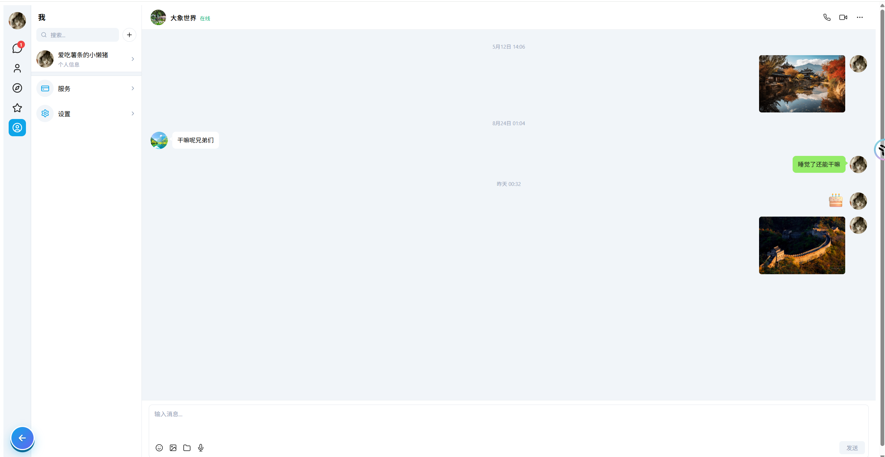

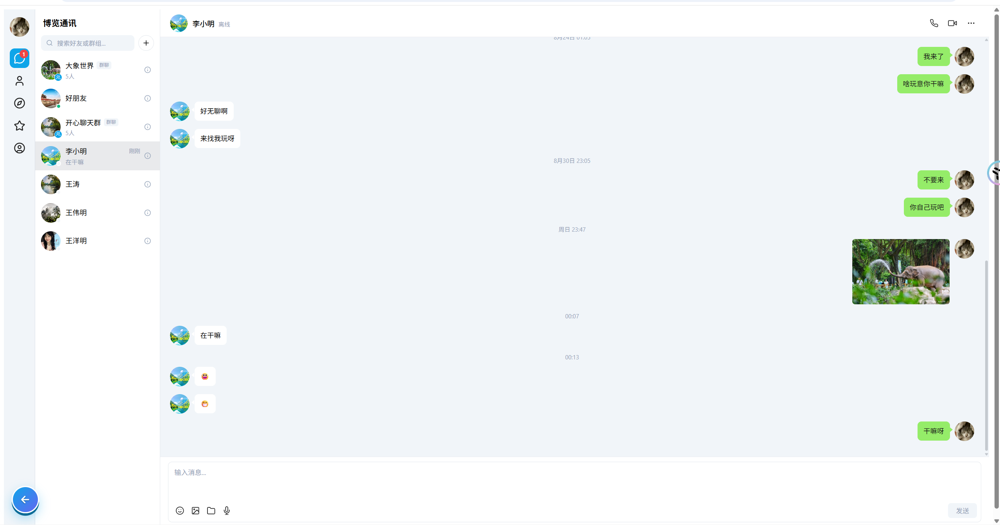

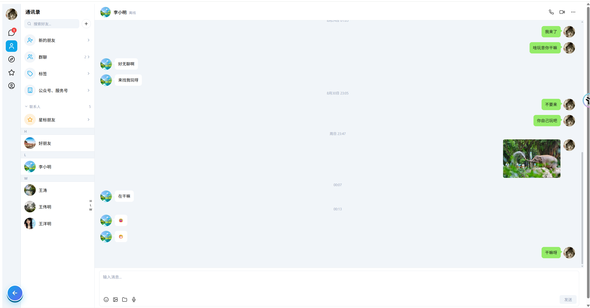

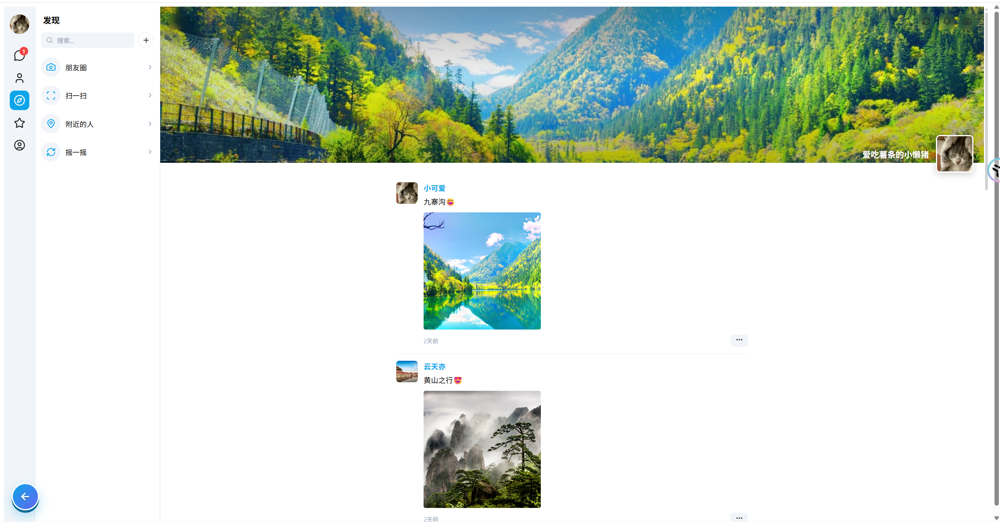

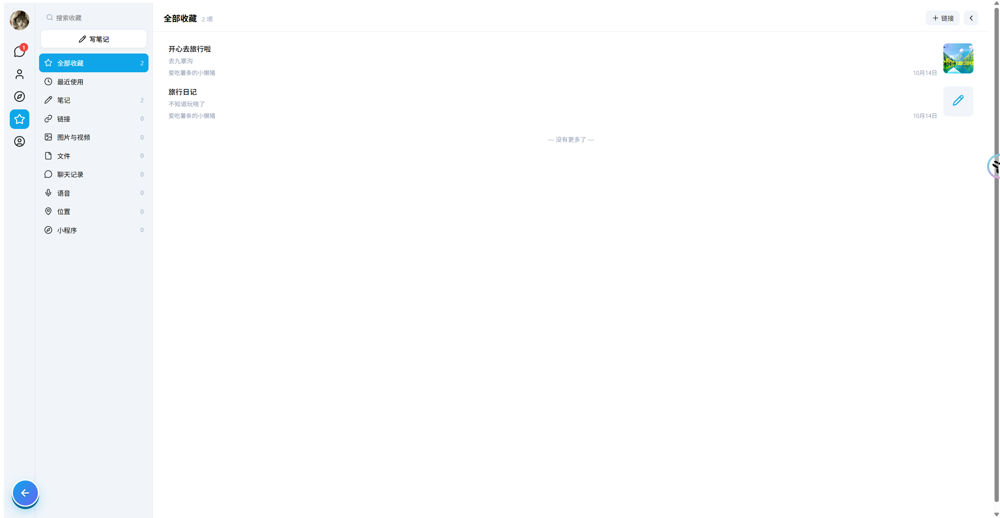

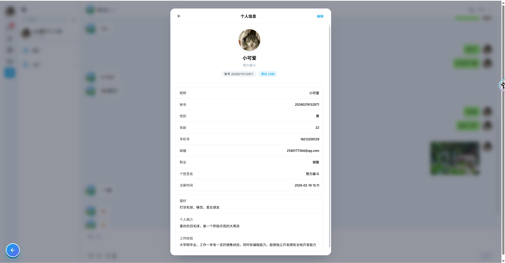

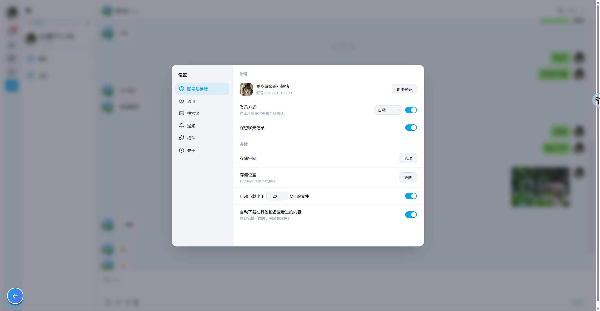

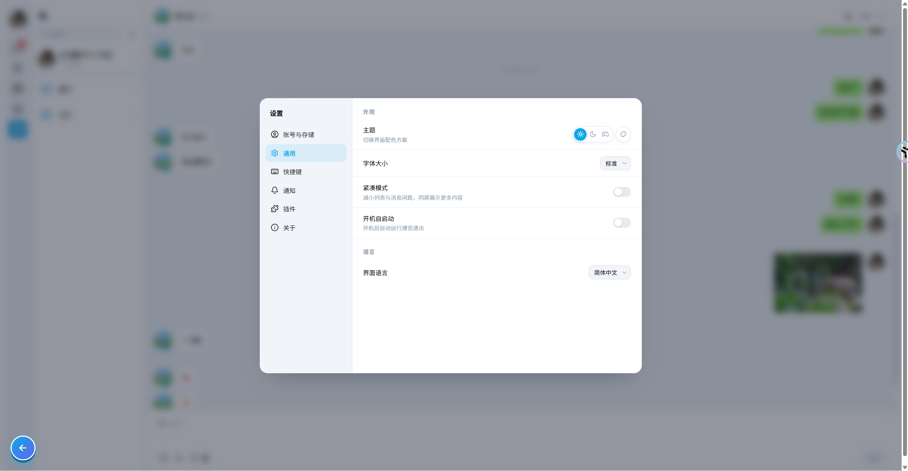

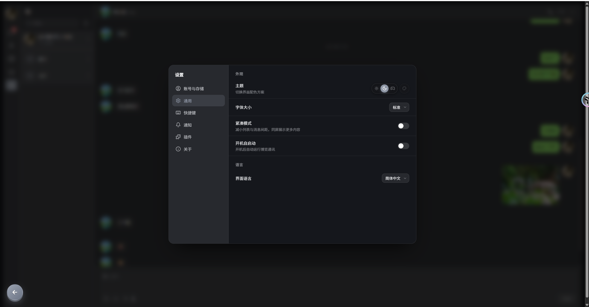

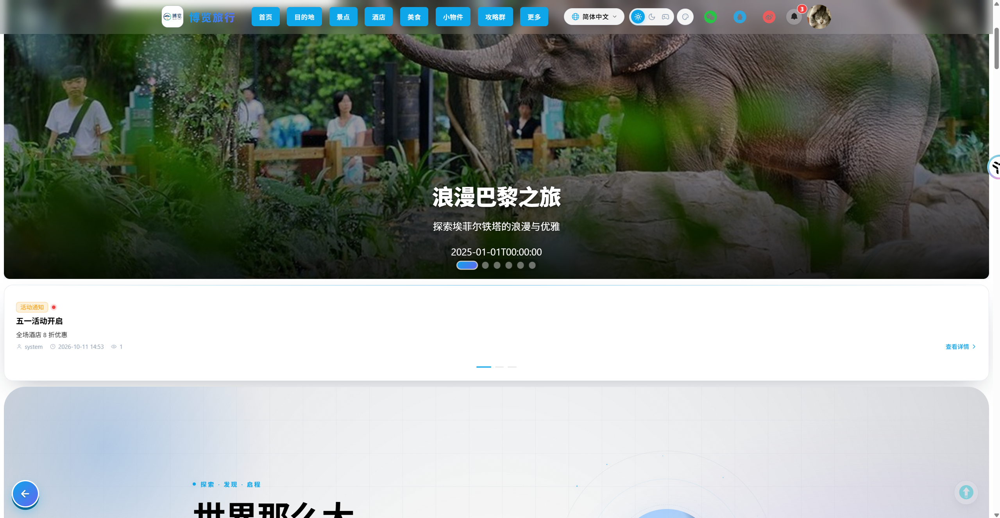

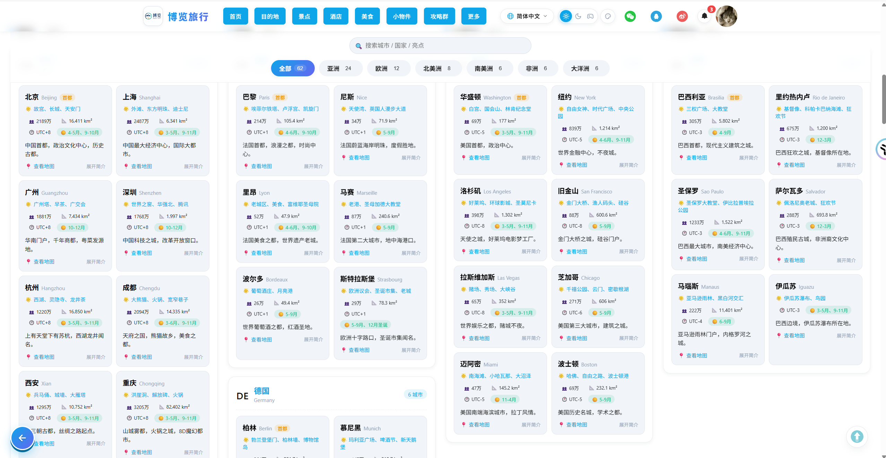

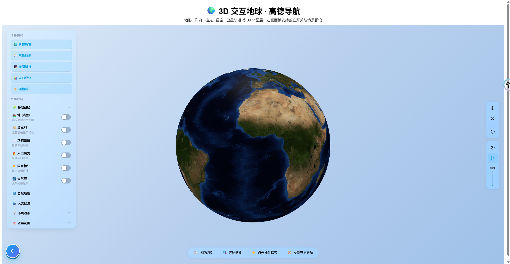

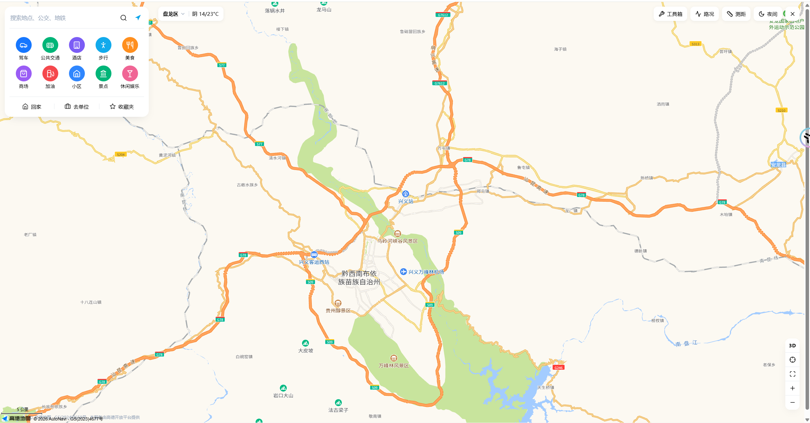

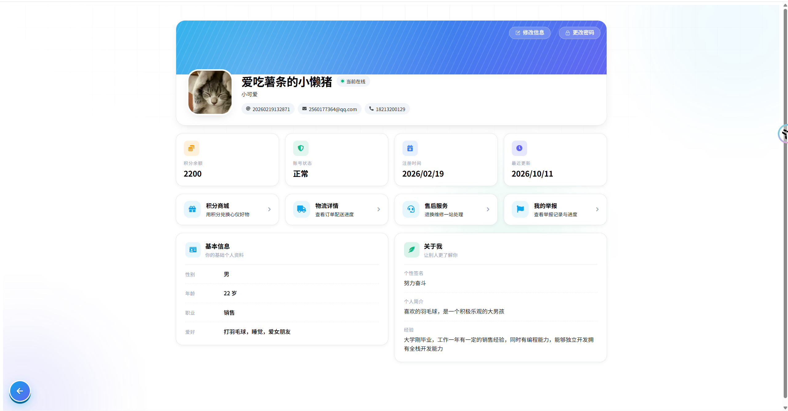

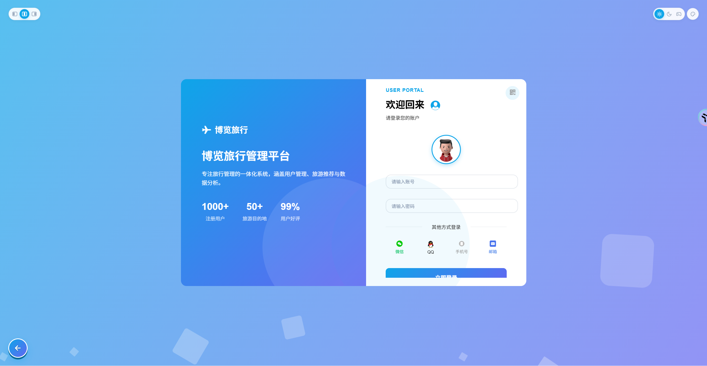

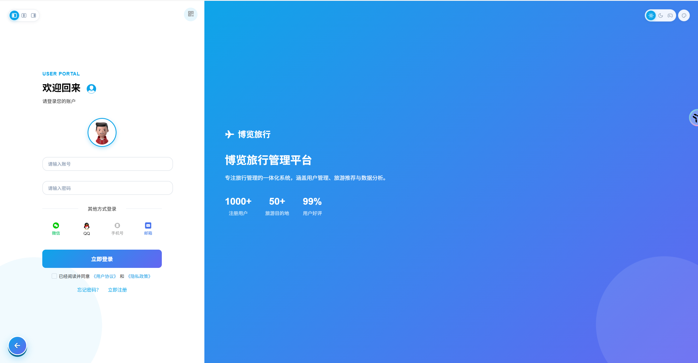

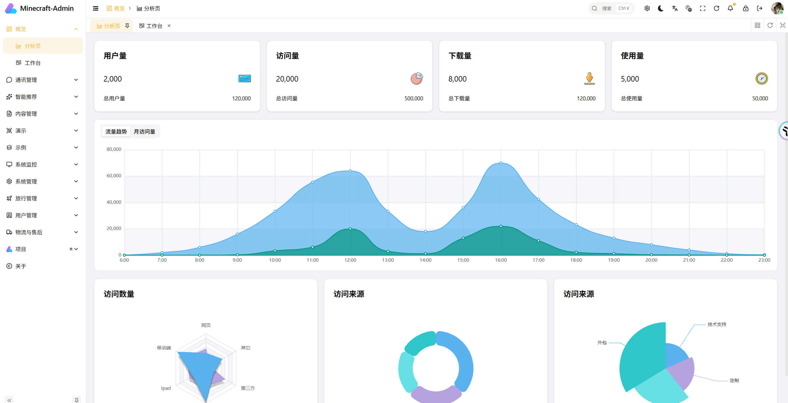

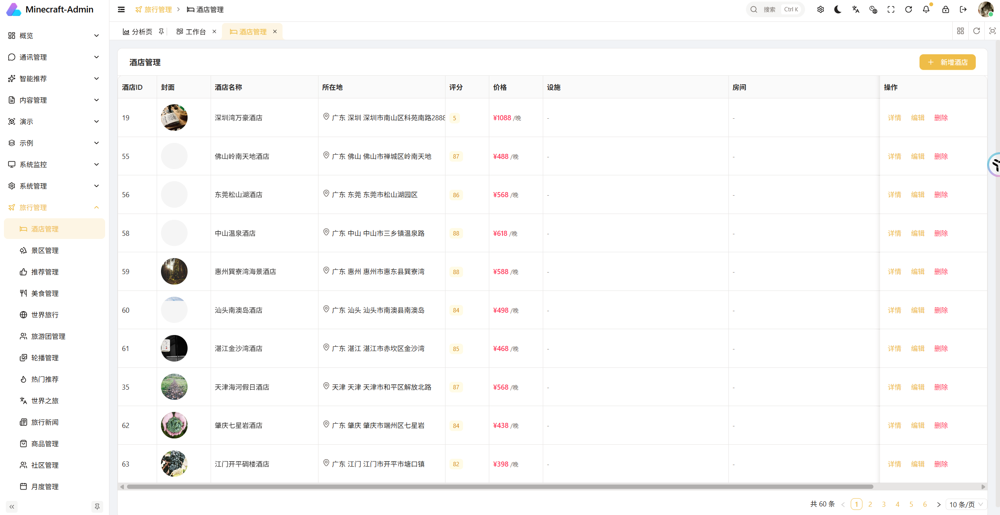

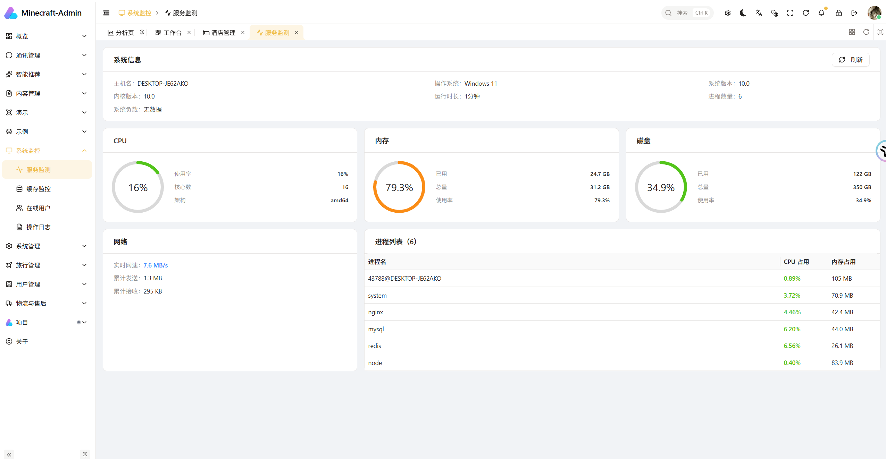

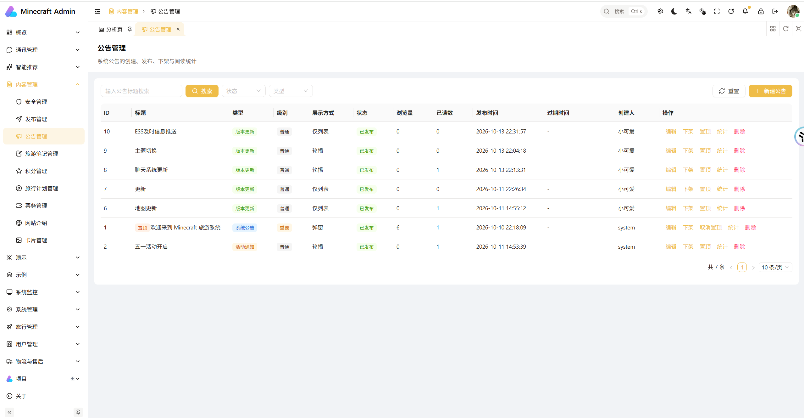
